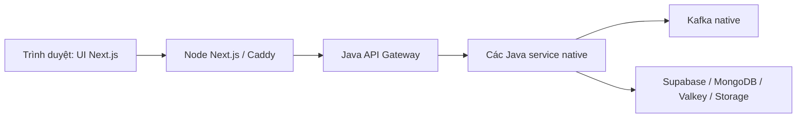

# Báo cáo nối UI Thiên Sơn với hạ tầng không Docker

Thực hiện24–25/10/2026, múi giờ Asia/Bangkok. Nhánh `codex/ui-backend-integration`, base UI `2d64d70` (nguồn BoyinGlasses `35da28f`). Nhật ký được ghi trong quá trình làm ở `docs/worklogs/2026-10-24-ui-backend-integration.md`.

## Kết quả chính để trình bày

UI vẫn dùng Next.js, React, TypeScript, Tailwind/Radix/Motion của Thiên Sơn. Thay nguồn dữ liệu demo trong trình duyệt bằng các API Java và JWT, nối chat/notification qua STOMP, giữ cách chạy native không Docker. Bản vá Next16.4.3 xử lý advisory phát hiện trong lúc build; không đổi framework.

Next phục vụ UI và proxy HTTP/WSS; gateway xác thực/routing; service xử lý nghiệp vụ và dữ liệu. Không chuyển credential DB/cloud xuống browser.

## Những việc đã làm

| Nhóm | Thay đổi | Mức kiểm tra |
|---|---|---|
| Phiên và hồ sơ | Login/register, JWT/refresh, logout, profile API, account IDs thật, draft theo tài khoản | Unit/HTTP fixture; API Java thật; browser Java thật cho login/profile/logout |
| Bài viết và media | Feed/chi tiết/CRUD, quyền comment, reaction/saved/report, multipart URL thật, lỗi giữ draft | Browser fixture; API Java/storage thật; browser Java thật cho đăng/reload bài riêng tư |
| Quan hệ và nhóm | Friend request ID, follow state; group/post/comment thành thảo luận | Browser fixture; DTO/controller được đối chiếu từ source |
| Realtime và stories | Hai kênh STOMP, server echo/dedup/read/reconnect, notification/read, story view/react/reply/upload, shared URL | Browser fixture hai tài khoản; chưa xác minh live Mongo ở môi trường hiện tại |
| Vận hành và tài liệu | Node runner, systemd/Caddy opt-in, CI Next, journal/contract/test/README/handoff | Native CLI regression, Caddy validate, auto-deploy unit, production build; chưa deploy cloud |

Các chỗ sửa để nối đúng dữ liệu: `authorId/content/mediaUrls/privacy` được chuyển sang model hiển thị; tên chỉ dùng để hiển thị, không làm khóa. Auth form không còn so sánh tài khoản mẫu. Thao tác chỉ xác nhận thành công khi server đã xác nhận; lỗi tải lại sau một mutation đã thành công không khiến người dùng gửi trùng. URL media không còn bị ghép sai vào thư mục assets.

## Bằng chứng kiểm tra

| Kiểm tra | Kết quả |
|---|---|
| Frontend unit + HTTP fixture + native STOMP + regression sau review | **21/21 đạt**, không skip |
| Browser production fixture | **3/3 nhóm đạt**: posts, screens, chat hai profile |
| Lint / TypeScript / production build | **Đạt**, Next16.4.3, Webpack |
| Native Node runner | **1/1 đạt**; build/dev/start, validation và child exit |
| Backend auto-deploy/Caddy opt-in | **8/8 đạt**; default404 giữ nguyên, flag loopback và rollback |
| Backend common + reaction unit | **34/34 đạt**; gồm regression transaction bỏ lưu |
| API Java native thật | **14 kiểm tra đạt**, gồm đăng ký/login/profile/feed/post/comment/reaction/saved/upload/refresh |
| Browser với Java backend thật | **5 kiểm tra đạt**: login/profile, post PRIVATE, reload persisted feed, settings, logout |
| Bỏ lưu sau sửa transaction | **3/3 kiểm tra API thật đạt**: save→unsave200→getMine null |
| Audit dependency production | **0 advisory** sau patch Next/eslint-config-next16.4.3 |

Browser fixture kiểm tra cả lỗi POST/PUT, giữ draft/file, settings hydrate, shared-link/plain text, comment đã lưu nhưng GET phụ lỗi, reaction summary lỗi, duplicate MESSAGE ID, chat read/reconnect/retry. Không dùng React internals hoặc seed session browser để coi như login đã thành công.

Probe live chạy Kafka và15 Java service native đã health UP, dùng gateway cấu hình thật **18080**. Proxy nhỏ trong lần kiểm tra browser chỉ chuyển tiếp request tới Java; không trả dữ liệu giả. Nội dung bài/comment/media thử đã được dọn; tài khoản kiểm tra riêng được giữ để tái lập, credential chỉ ở `.runtime/checks/ui-live/` bị Git ignore.

## Các lỗi thật đã tìm và xử lý

1. UI lưu local thay vì gọi server → thay bằng HTTP client/provider/actions thật, chuyển model theo API.
2. Comment đã POST thành công nhưng GET đồng bộ thất bại → dùng DTO đã xác nhận, đồng bộ phụ không báo mutation thất bại; regression RED rồi GREEN.
3. Tin nhắn mới ở cuộc trò chuyện đang mở chưa mark-read → gọi read API và cập nhật badge; test hai tài khoản xác nhận readBy.
4. Share URL chỉ là text và Settings có nguy cơ hydrate rỗng → Link nội bộ đã validate, chờ profile/self identity và kiểm tra reload thật.
5. `SavedItemService.unsave` thiếu transaction → thêm `@Transactional`; test Spring advice RED/GREEN và API Java thật đạt sau rebuild riêng service.

Review độc lập snapshot `3e6afd6` tìm thêm 5 lỗi P2 và bản sửa `24e8e7e` xử lý: reconnect tải bù lịch sử; snapshot REST giữ tin realtime; echo ID cũ không xác nhận SEND mới; bài share giữ liên kết gốc; notification COMMENT giữ đích thông báo hợp lệ thay vì dựng post route từ comment ID. Regression logic provider6/6 và adapter/render3/3 đạt; browser sau sửa3/3 và production build cuối trỏ18080. Chi tiết RED/GREEN và giới hạn correlation ID ở [nhật ký sửa review](../worklogs/2026-10-25-ui-review-fixes.md).

Reviewer kiểm tra lại đúng năm phát hiện, chạy độc lập9/9 regression đạt và xác nhận đóng F1–F5; kết luận ở mục5 [báo cáo review](../reviews/2026-10-25-ui-backend-review.md). Không phát hiện lỗi trực tiếp bổ sung trong phạm vi kiểm tra lại.

## Giới hạn vận hành được giữ rõ

- MongoDB Atlas probe cho story/reels/chat/notification hiện lỗi TLS `internal_error` từ máy thực thi. UI các luồng này đã nối và đạt contract/browser fixture; cần kiểm tra lại TLS/network/allowlist Atlas rồi chạy live bốn service, không tắt TLS để né lỗi.
- Kafka data cũ gặp Windows file-lock ở compaction. Lần kiểm tra live dùng vùng data Kafka probe riêng; không xóa hoặc di chuyển dữ liệu Kafka cũ. Đây là bước cô lập môi trường kiểm tra, không phải thay cấu hình production.
- Chưa bật Azure VM, đổi Cloudflare Pages hoặc cài systemd trên Linux; chưa chạy workflow trên GitHub hosted. Backend release hiện không tự đóng gói UI; hướng dẫn native nêu cách quản lý service UI riêng và flag Caddy.
- Location composer chỉ là draft vì API Post chưa có trường đó; theme/popup/drafts là local theo tài khoản. Following list là các account đã tải/kiểm tra, vì backend chưa có endpoint list-following. Các tài liệu/test demo cũ giữ làm lịch sử, không coi là nghiệm thu mới.

## Cách trình bày ngắn khi báo cáo

1. Nêu trước/sau: trước đây UI demo dùng dữ liệu browser; hiện UI giữ nguyên stack nhưng gọi Java APIs và dùng JWT thật.
2. Vẽ luồng browser→Next/Caddy→gateway→service/Kafka→cloud stores, giải thích mỗi phần chạy native.
3. Demo login, bài PRIVATE, reload vẫn còn bài, sửa profile và logout; trích kết quả hai tài khoản chat từ bộ fixture, nói rõ mức xác minh.
4. Dẫn một lỗi tích hợp thực tế đã sửa: transaction bỏ lưu hoặc mutation thành công/GET phụ thất bại; đưa test RED/GREEN thay vì chỉ nói “đã chạy”.

Bước vận hành tiếp theo sau review: khôi phục kết nối Mongo Atlas của môi trường và xác minh live realtime, rồi chọn thời điểm triển khai Node/Caddy bằng quy trình đã ghi.
